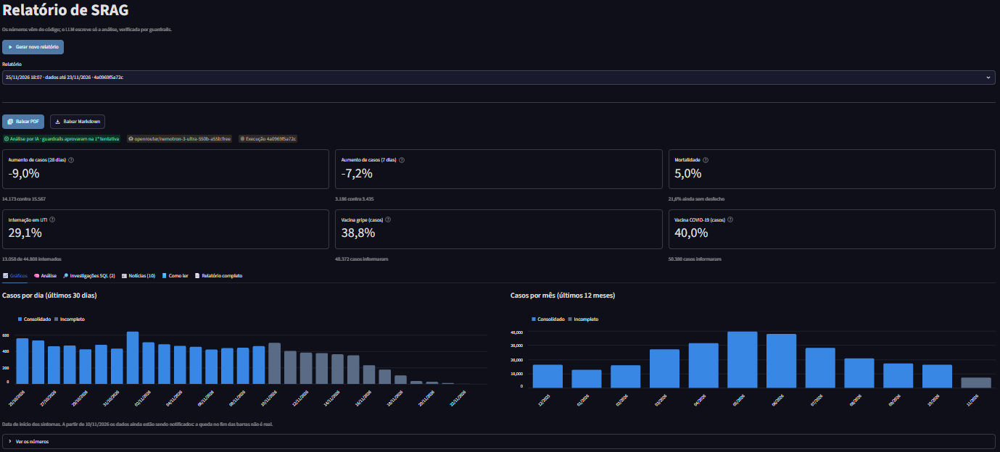
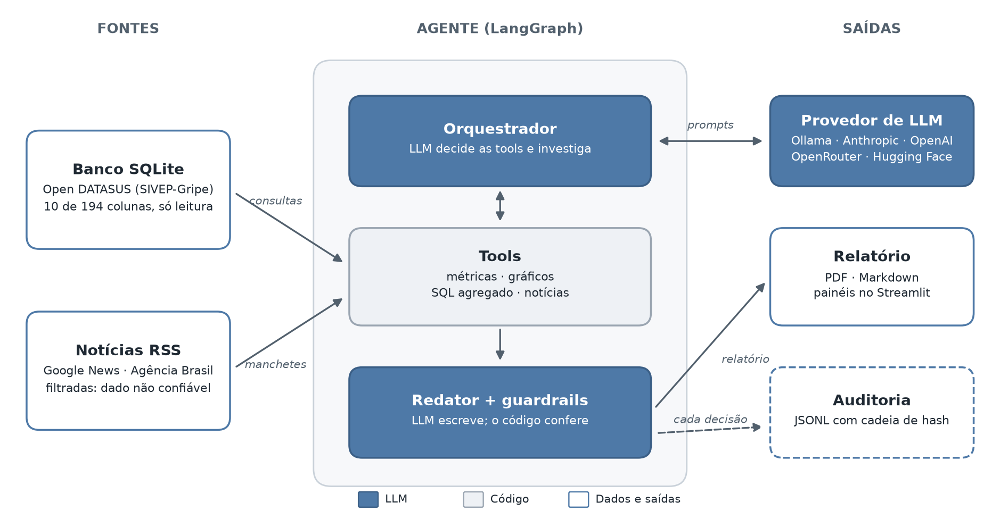
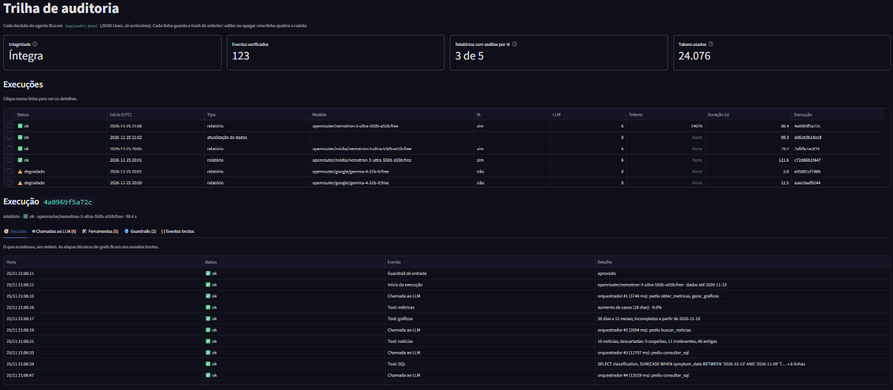

# datasus-srag-agent

[](https://github.com/PLeonLopes/datasus-srag-agent/actions/workflows/ci.yml)
[](https://www.python.org/)
[](https://docs.astral.sh/uv/)
[](https://langchain-ai.github.io/langgraph/)
[](https://streamlit.io/)
[](./docs/arquitetura.md#provedores-de-llm)
[](https://dadosabertos.saude.gov.br/dataset/srag-2019-a-2026)
[](./LICENSE)

> Um agente de IA que transforma os dados públicos de SRAG do Open DATASUS e as notícias do dia num relatório
> auditável para profissionais de saúde.

| <div align="center">Página de relatório: análise por IA aprovada pelos guardrails, os seis indicadores e os painéis de gráficos, análise, investigações SQL e notícias</div> |
|---|
|  |

> [!TIP]
> O diagrama da arquitetura está em [`docs/arquitetura.pdf`](./docs/arquitetura.pdf) e um relatório real gerado pelo
> agente, em [`docs/exemplo/relatorio.pdf`](./docs/exemplo/relatorio.pdf).

---

## Visão Geral

Prova de conceito para ajudar profissionais de saúde a acompanhar a severidade e o avanço da Síndrome Respiratória Aguda Grave (SRAG). Um agente em **LangGraph** consulta os dados de internações do **Open DATASUS**, investiga com SQL, cruza os números com **notícias recentes** e escreve um relatório com quatro métricas (aumento de casos, mortalidade, UTI e vacinação), dois gráficos e uma análise do cenário.

O código calcula todos os números; o LLM decide o que investigar e escreve a análise, que só entra no relatório depois de passar pelos guardrails. Cada decisão fica numa trilha de auditoria verificável.

<sub>Desenvolvido como projeto final da certificação interna de AI Engineering da Indicium.</sub>

---

## Como Funciona

Ao clicar em **Gerar novo relatório**, o sistema:

1. **Confere os dados:** o guardrail de entrada valida o banco e avisa se o snapshot é antigo.
2. **Reúne as evidências:** o orquestrador chama métricas, gráficos e notícias; se elas divergirem dos números, escreve até 3 consultas SQL para investigar.
3. **Escreve a análise:** o redator recebe só agregados e manchetes, marcadas como dado não confiável.
4. **Confere o texto:** os guardrails aprovam ou devolvem a análise com as violações; na segunda recusa, entra um texto de reserva "sem IA".
5. **Entrega:** relatório em PDF, Markdown e JSON, aberto em painéis na interface, com a execução inteira na página Auditoria.

---

## Arquitetura

| <div align="center">Fontes à esquerda, o agente no centro e as saídas à direita. Em azul, as etapas com LLM; em cinza, o código</div> |
|---|
|  |

Fluxo do grafo, componentes, decisões de projeto e provedores de LLM: [`docs/arquitetura.md`](./docs/arquitetura.md).

### Tech Stack

| Componente | Tecnologia |
|---|---|
| Agente | LangGraph, LangChain |
| LLM | Ollama, Anthropic, OpenAI, OpenRouter, Hugging Face |
| Dados | pandas, Parquet, SQLite |
| Interface | Streamlit |
| Qualidade | pytest, ruff, uv, GitHub Actions |

---

## Dados e Métricas

Arquivos do ano corrente e do anterior do [SRAG 2019 a 2026](https://dadosabertos.saude.gov.br/dataset/srag-2019-a-2026), baixados automaticamente e carregados num SQLite com **só 10 das 194 colunas** (589.437 casos no snapshot de 23/11/2026).

| Métrica | Definição | Exemplo |
|---|---|---|
| Aumento de casos | Últimos 28 dias contra os 28 anteriores | **-9,0%** |
| Mortalidade | Óbitos por SRAG entre os casos com desfecho (90 dias) | **5,0%** |
| Internação em UTI | Internados em UTI entre os internados com a informação (90 dias) | **29,1%** |
| Vacinação entre os casos | Vacinados entre os casos que informaram (90 dias) | **38,8%** gripe · **40,0%** COVID-19 |

As janelas terminam 14 dias antes dos dados, porque os casos recentes ainda estão sendo notificados. UTI e vacinação são medidas entre os casos: a base não tem leitos nem população. Detalhes da ingestão, das colunas e das definições: [`docs/dados-e-metricas.md`](./docs/dados-e-metricas.md).

---

## Governança, Guardrails e Dados Sensíveis

- **Auditoria verificável:** cada prompt, resposta, ferramenta e decisão vai para um JSONL encadeado por hash; editar, apagar ou cortar linhas é detectado.
- **Guardrails em código:** SQL só de leitura e agregado, notícias filtradas contra injeção de prompt e texto conferido na saída (todo número existe nos dados; sem previsões, conselhos médicos ou termos enganosos).
- **Dados sensíveis:** allowlist de colunas, idade em faixa etária, grupos com menos de 5 casos omitidos e só agregados enviados ao LLM.
- **Falhas e custo:** no máximo 7 chamadas ao LLM por relatório; se o modelo falhar, o relatório sai com texto de reserva marcado "sem IA".

Eventos auditados, tabela completa de guardrails e o que as execuções reais ensinaram: [`docs/governanca.md`](./docs/governanca.md).

---

## Execução de Exemplo

Uma execução real está em [`docs/exemplo/`](./docs/exemplo/): o relatório em [PDF](./docs/exemplo/relatorio.pdf) e [Markdown](./docs/exemplo/relatorio.md), os gráficos e a trilha de auditoria. O agente investigou com SQL a divergência entre as notícias e os dados, e o texto foi aprovado na primeira tentativa:

> Os casos de COVID-19, embora em alta (280 contra 202 nos últimos 7 dias), representam parcela minoritária do total. [...] As notícias que alertam para pressão de COVID-19 em internações e alta em múltiplos estados concordam com o crescimento observado para esse agente, mas divergem da tendência geral de SRAG, que segue em redução puxada pelos demais grupos etiológicos.

Para conferir que o recorte da auditoria não foi alterado:

```bash
uv run python -c "from pathlib import Path; from srag_agent.governance.audit import verify_chain; print(verify_chain(Path('docs/exemplo/auditoria_exemplo.jsonl'), partial=True))"
```

---

## Funcionalidades

| <div align="center">Página de auditoria: integridade da cadeia, execuções e, para a execução escolhida, decisões, chamadas ao LLM, ferramentas e guardrails</div> |
|---|
|  |

- **Relatório em painéis**, com download em PDF e Markdown e relatórios anteriores abertos sem gastar cota.
- **Escolha do modelo numa lista**, só com modelos que suportam *tool calling*.
- **Atualização dos dados num botão**, registrada na auditoria.
- **Auditoria navegável**, com prompts e respostas de cada chamada ao LLM.

---

## Requisitos do Desafio

| Requisito | Onde está |
|---|---|
| Agente que consulta o banco e traz as métricas | `agent/graph.py`, `tools/metrics.py`, `tools/sql.py` |
| Gráfico diário (30 dias) e mensal (12 meses) | `tools/charts.py` |
| Notícias sobre SRAG para embasar a análise | `tools/news.py` |
| Dados reais do Open DATASUS, com seleção de colunas e tratamento | `data/`, [`docs/dados-e-metricas.md`](./docs/dados-e-metricas.md) |
| Governança, guardrails e dados sensíveis | `governance/`, [`docs/governanca.md`](./docs/governanca.md) |
| Clean code | Pacote por responsabilidade, ruff, 262 testes, CI |
| Diagrama conceitual em PDF | [`docs/arquitetura.pdf`](./docs/arquitetura.pdf) |

---

## Estrutura do Projeto

```
datasus-srag-agent/
├── src/srag_agent/
│   ├── data/          # Download, allowlist, ETL e acesso somente leitura
│   ├── tools/         # Métricas, gráficos, SQL com guardrails, notícias
│   ├── agent/         # Grafo, prompts, relatório (MD, JSON, PDF) e runner
│   ├── governance/    # Trilha de auditoria e guardrails
│   ├── llm/           # Fábrica de modelos, catálogo e erros
│   └── ui/            # Lógica testável da interface
├── app/               # Interface Streamlit
├── tests/             # 262 testes (sem rede e sem LLM real)
└── docs/              # Arquitetura, dados, governança, diagrama e exemplo
```

---

## Instalação e Execução

**Pré-requisitos:** Linux, macOS ou WSL2, [uv](https://docs.astral.sh/uv/getting-started/installation/) e um provedor de LLM ([Ollama](https://ollama.com/) local, sem chave, ou a chave de um provedor).

```bash
git clone https://github.com/PLeonLopes/datasus-srag-agent.git
cd datasus-srag-agent
uv sync
cp .env.example .env                          # provedor, modelo e chave
uv run python -m srag_agent.data.download     # dados mais recentes (~45 MB)
uv run python -m srag_agent.data.etl          # carrega o SQLite
uv run streamlit run app/streamlit_app.py     # http://localhost:8501
```

| Variável | Para quê |
|---|---|
| `SRAG_LLM_PROVIDER` | `ollama`, `anthropic`, `openai`, `openrouter` ou `huggingface` |
| `SRAG_LLM_MODEL` | Modelo (também pode ser escolhido na interface) |
| `SRAG_LLM_MAX_RETRIES` | Use `0` no OpenRouter gratuito: cada retentativa consome a cota |
| `ANTHROPIC_API_KEY`, `OPENAI_API_KEY`, `OPENROUTER_API_KEY`, `HF_TOKEN` | Chave do provedor escolhido |

<details>
<summary>Linha de comando, dados sintéticos e testes</summary>

```bash
# Relatório sem a interface
SRAG_LLM_MAX_RETRIES=0 uv run python -m srag_agent.agent --provider openrouter --model nvidia/nemotron-3-ultra-550b-a55b:free

# Dados sintéticos numa pasta separada (os dados reais não são tocados)
export SRAG_DATA_DIR=data/demo
uv run python -m srag_agent.data.synthetic --dest data/demo/raw
uv run python -m srag_agent.data.etl

# Testes e lint (o mesmo que o CI roda em Python 3.12 e 3.13)
uv run pytest
uv run ruff check .
```

</details>

Os relatórios saem em `reports/<data>_<run_id>/` e a trilha em `logs/audit.jsonl`, ambos fora do Git.

---

## Limitações

- O guardrail confere que cada número existe nos dados, não que foi atribuído ao período certo: revisão humana recomendada.
- Os guardrails de conteúdo são baseados em padrões e não cobrem toda reformulação.
- As taxas mudam a cada snapshot semanal; cerca de 22% dos casos da janela ainda não têm desfecho.
- Modelos gratuitos podem ficar sobrecarregados (429); o relatório sai, mas com texto de reserva.

---

## Créditos

- Dados: [Open DATASUS, SRAG 2019 a 2026 (SIVEP-Gripe)](https://dadosabertos.saude.gov.br/dataset/srag-2019-a-2026), Ministério da Saúde.
- Notícias: RSS do [Google News](https://news.google.com/) e da [Agência Brasil](https://agenciabrasil.ebc.com.br/).

---

## Licença

[MIT](./LICENSE).
