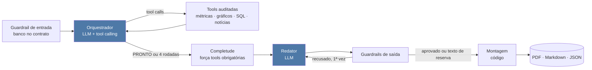

# Arquitetura

[← Voltar ao README](../README.md)

O diagrama conceitual está em [`arquitetura.pdf`](./arquitetura.pdf). Aqui está o detalhe do agente.

## Fluxo do agente

O LLM decide a ordem das ferramentas e o que investigar com SQL. O código garante as ferramentas obrigatórias, limita o custo (no máximo 7 chamadas ao LLM por relatório) e valida o texto antes de ele entrar no relatório.

## Componentes

| Componente | O que faz | Código |
|---|---|---|
| Orquestrador | Grafo com 6 nós (2 com LLM, 4 de código), limites de rodadas e tentativas | `src/srag_agent/agent/graph.py` |
| Tools | Ligadas a cada execução: guardam as evidências, registram cada chamada, limitam o SQL a 3 consultas | `src/srag_agent/agent/toolkit.py` |
| Métricas e gráficos | pandas + SQL; PNG para o relatório e gráficos interativos na interface | `src/srag_agent/tools/metrics.py`, `charts.py` |
| SQL livre | Validação em camadas (parser, authorizer do SQLite, timeout) | `src/srag_agent/tools/sql.py` |
| Notícias | RSS do Google News e da Agência Brasil, tratado como dado não confiável | `src/srag_agent/tools/news.py` |
| LLM | Fábrica por configuração, catálogo de modelos e classificação de erros | `src/srag_agent/llm/` |
| Governança | Trilha de auditoria e guardrails | `src/srag_agent/governance/` |
| Relatório | Markdown, JSON e PDF montados pelo código | `src/srag_agent/agent/report.py`, `pdf.py` |
| Interface | Páginas de relatório e de auditoria | `app/` |

## Decisões de projeto

| # | Decisão | Alternativa descartada | Por quê |
|---|---|---|---|
| 1 | Agente com *tool calling* + nós de código | Pipeline fixo, ou o LLM livre fazendo tudo | O LLM investiga; o código garante o mínimo, o custo e a validação |
| 2 | Métricas em pandas; SQL livre só para investigar | Text-to-SQL para tudo | O número oficial nunca é gerado pelo modelo |
| 3 | "RAG estruturado" (SQL) em vez de banco vetorial | FAISS/BM25 sobre manchetes | Números exigem SQL, não similaridade; as notícias cabem no contexto |
| 4 | Parquet e SQLite | CSV em memória, SGBD em servidor | Lê só as colunas necessárias; banco local, somente leitura |
| 5 | Datas a partir do snapshot, com corte de 14 dias | Janelas a partir de hoje | Arquivo antigo não finge estar atualizado; dias recentes não viram queda falsa |
| 6 | Mortalidade, UTI e vacinação em 90 dias | Mesma janela de 28 dias | Desfechos e internações demoram; o % sem desfecho é exibido |
| 7 | Redefinir UTI e vacinação e bloquear os termos | Usar os nomes do enunciado | A base não tem leitos nem população |
| 8 | Guardrail de números estrito (sem arredondar) | Tolerar arredondamento | O texto nunca diverge das tabelas |
| 9 | Notícias por RSS gratuito | Tavily (pago) | Custo zero; a interface `NewsProvider` permite trocar |
| 10 | Provedor de LLM configurável | Provedor fixo | Ollama, Anthropic, OpenAI, OpenRouter e Hugging Face com o mesmo código |
| 11 | Texto livre + guardrails | Saída estruturada | Mais robusto em modelos gratuitos; a validação é em código |
| 12 | JSONL com cadeia de hash e `.head` | Logs de texto | Auditoria verificável e detecção de adulteração |

## Provedores de LLM

O agente exige um modelo com *tool calling*; a interface lista só esses modelos.

| Provedor | Cliente | Situação neste projeto |
|---|---|---|
| OpenRouter | `ChatOpenAI` (API compatível) | `nvidia/nemotron-3-ultra-550b-a55b:free`: execuções completas, texto aprovado na 1ª tentativa. `google/gemma-4-31b-it:free`: 429 do provedor (sobrecarga), relatório saiu com texto de reserva |
| Ollama | `ChatOllama` | Suportado (padrão `qwen3:8b`); não testado com o agente real |
| Anthropic | `ChatAnthropic` | Suportado (padrão `claude-opus-5-5`, sem `temperature`); não testado com o agente real |
| OpenAI, Hugging Face | `ChatOpenAI` | Suportados pelo mesmo caminho do OpenRouter; não testados com o agente real |

A suíte de testes usa um LLM roteirizado, que cobre todos os caminhos do grafo sem rede.
