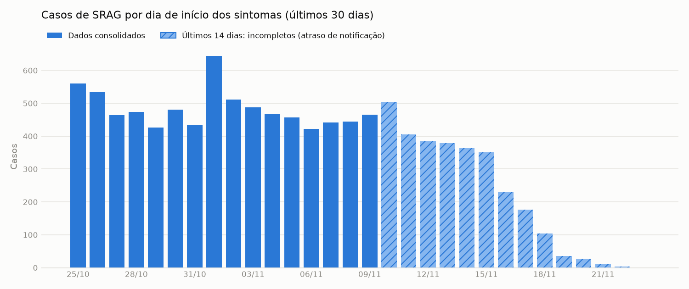
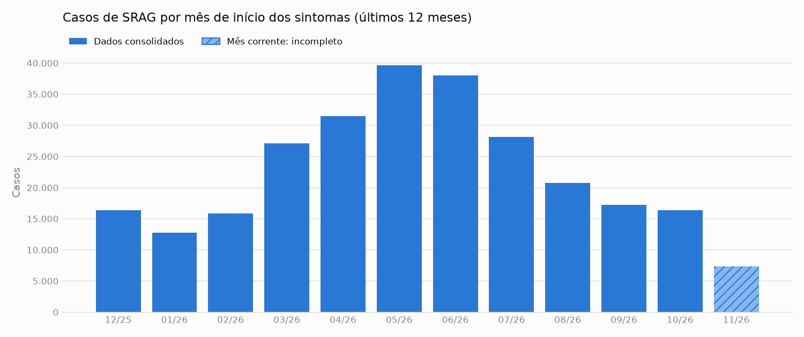

# Relatório de SRAG: dados até 23/11/2026

Gerado em 25/11/2026 21:06 (UTC) · execução `4a0969f5a72c` · modelo `openrouter/nemotron-3-ultra-550b-a55b:free` · fonte: Open DATASUS (SIVEP-Gripe)

## Métricas

| Métrica | Valor | Base | Período |
|---|---|---|---|
| Taxa de aumento de casos (28 dias) | **-9,0%** | 14.173 casos contra 15.567 no período anterior | 13/10/2026 a 09/11/2026 |
| Taxa de aumento de casos (7 dias) | **-7,2%** | 3.186 casos contra 3.435 no período anterior | 03/11/2026 a 09/11/2026 |
| Taxa de mortalidade | **5,0%** | 1.940 óbitos por SRAG em 38.516 casos com desfecho (21,6% dos casos ainda sem desfecho) | 12/08/2026 a 09/11/2026 |
| Taxa de internação em UTI | **29,1%** | 13.058 em UTI de 44.808 internados com UTI informada | 12/08/2026 a 09/11/2026 |
| Vacinação contra gripe (entre os casos) | **38,8%** | 18.755 vacinados de 48.372 casos que informaram | 12/08/2026 a 09/11/2026 |
| Vacinação contra COVID-19 (entre os casos) | **40,0%** | 20.141 vacinados de 50.380 casos que informaram | 12/08/2026 a 09/11/2026 |

> Todas as janelas terminam 14 dias antes da data dos dados, porque os casos recentes ainda estão sendo notificados. A taxa de UTI mede a gravidade dos internados, **não** a ocupação de leitos, e a vacinação é medida entre os casos de SRAG, **não** na população: a base não tem número de leitos nem população.

## Casos diários (últimos 30 dias)



Dias a partir de 10/11/2026 ainda estão incompletos.

<details><summary>Tabela</summary>

| Dia | Casos |
|---|---|
| 25/10/2026 | 560 |
| 26/10/2026 | 535 |
| 27/10/2026 | 464 |
| 28/10/2026 | 473 |
| 29/10/2026 | 426 |
| 30/10/2026 | 481 |
| 31/10/2026 | 435 |
| 01/11/2026 | 644 |
| 02/11/2026 | 512 |
| 03/11/2026 | 488 |
| 04/11/2026 | 468 |
| 05/11/2026 | 457 |
| 06/11/2026 | 422 |
| 07/11/2026 | 441 |
| 08/11/2026 | 445 |
| 09/11/2026 | 465 |
| 10/11/2026 | 505 |
| 11/11/2026 | 406 |
| 12/11/2026 | 384 |
| 13/11/2026 | 379 |
| 14/11/2026 | 364 |
| 15/11/2026 | 351 |
| 16/11/2026 | 230 |
| 17/11/2026 | 176 |
| 18/11/2026 | 104 |
| 19/11/2026 | 35 |
| 20/11/2026 | 27 |
| 21/11/2026 | 10 |
| 22/11/2026 | 4 |
| 23/11/2026 | 0 |

</details>

## Casos mensais (últimos 12 meses)



O mês corrente ainda está incompleto.

<details><summary>Tabela</summary>

| Mês | Casos |
|---|---|
| 12/2025 | 16.357 |
| 01/2026 | 12.794 |
| 02/2026 | 15.877 |
| 03/2026 | 27.094 |
| 04/2026 | 31.526 |
| 05/2026 | 39.657 |
| 06/2026 | 37.975 |
| 07/2026 | 28.138 |
| 08/2026 | 20.730 |
| 09/2026 | 17.205 |
| 10/2026 | 16.326 |
| 11/2026 | 7.317 |

</details>

## Análise do cenário

> Texto gerado por IA (`openrouter/nemotron-3-ultra-550b-a55b:free`) e aprovado pelos guardrails automáticos na tentativa 1. Revisão humana recomendada.

No período de 28 dias encerrado em 09/11/2026, os casos de SRAG apresentaram queda de 9,0% (14.173 contra 15.567 no período anterior, de 15/09 a 12/10/2026). A redução reflete principalmente o declínio nas classificações "não especificado" (5.685 contra 7.561) e "outros vírus respiratórios" (3.593 contra 4.997). Em contrapartida, os casos "sem classificação" aumentaram (3.482 contra 1.785) e os de COVID-19 mais que dobraram (780 contra 367). Na janela de 7 dias (03/11 a 09/11/2026), a queda foi de 7,2% (3.186 contra 3.435), com padrão semelhante.

Os casos de COVID-19, embora em alta (280 contra 202 nos últimos 7 dias), representam parcela minoritária do total. O aumento concentra-se em São Paulo (302 casos no período de 28 dias), Rio de Janeiro (105), Minas Gerais (99), Paraná (54) e Distrito Federal (52). As notícias que alertam para pressão de COVID-19 em internações e alta em múltiplos estados concordam com o crescimento observado para esse agente, mas divergem da tendência geral de SRAG, que segue em redução puxada pelos demais grupos etiológicos.

A mortalidade entre os casos com desfecho foi de 5,0% (1.940 óbitos em 38.516 casos, de 12/08 a 09/11/2026). A proporção de internados que foram para a UTI atingiu 29,1% (13.058 de 44.808). A vacinação entre os casos de SRAG foi de 38,8% para influenza (18.755 de 48.372) e 40,0% para COVID-19 (20.141 de 50.380), no mesmo período. Dados recentes são incompletos a partir de 10/11/2026, e 21,6% dos casos ainda não têm desfecho informado, o que pode alterar os indicadores à medida que as notificações se consolidarem.

## Investigações do agente (SQL)

```sql
SELECT classification,
       SUM(CASE WHEN symptom_date BETWEEN '2026-10-13' AND '2026-11-09' THEN 1 ELSE 0 END) AS current_28d,
       SUM(CASE WHEN symptom_date BETWEEN '2026-09-15' AND '2026-10-12' THEN 1 ELSE 0 END) AS previous_28d,
       SUM(CASE WHEN symptom_date BETWEEN '2026-11-03' AND '2026-11-09' THEN 1 ELSE 0 END) AS current_7d,
       SUM(CASE WHEN symptom_date BETWEEN '2026-10-27' AND '2026-11-02' THEN 1 ELSE 0 END) AS previous_7d
FROM cases
WHERE symptom_date BETWEEN '2026-09-15' AND '2026-11-09'
GROUP BY classification
HAVING current_28d >= 5 OR previous_28d >= 5
ORDER BY current_28d DESC
```

| classification | current_28d | previous_28d | current_7d | previous_7d |
|---|---|---|---|---|
| unspecified | 5.685 | 7.561 | 1.011 | 1.336 |
| other_respiratory_virus | 3.593 | 4.997 | 607 | 823 |
| não informado | 3.482 | 1.785 | 1.173 | 913 |
| covid19 | 780 | 367 | 280 | 202 |
| influenza | 484 | 634 | 83 | 109 |
| other_agent | 149 | 223 | 32 | 52 |

```sql
SELECT state,
       SUM(CASE WHEN symptom_date BETWEEN '2026-10-13' AND '2026-11-09' THEN 1 ELSE 0 END) AS current_28d,
       SUM(CASE WHEN symptom_date BETWEEN '2026-09-15' AND '2026-10-12' THEN 1 ELSE 0 END) AS previous_28d,
       SUM(CASE WHEN symptom_date BETWEEN '2026-11-03' AND '2026-11-09' THEN 1 ELSE 0 END) AS current_7d,
       SUM(CASE WHEN symptom_date BETWEEN '2026-10-27' AND '2026-11-02' THEN 1 ELSE 0 END) AS previous_7d
FROM cases
WHERE classification = 'covid19'
  AND symptom_date BETWEEN '2026-09-15' AND '2026-11-09'
GROUP BY state
HAVING current_28d >= 5 OR previous_28d >= 5
ORDER BY current_28d DESC
```

| state | current_28d | previous_28d | current_7d | previous_7d |
|---|---|---|---|---|
| SP | 302 | 129 | 99 | 82 |
| RJ | 105 | 21 | 50 | 23 |
| MG | 99 | 30 | 46 | 18 |
| PR | 54 | 16 | 16 | 22 |
| DF | 52 | 37 | 15 | 13 |
| BA | 35 | 19 | 8 | 12 |
| RS | 23 | 6 | 11 | 4 |
| GO | 22 | 24 | 6 | 8 |
| SC | 19 | 4 | 7 | 4 |
| MT | 14 | 22 | 4 | 2 |
| ES | 14 | 3 | 8 | 3 |
| MS | 11 | 2 | 4 | 3 |
| PB | 6 | 3 | 1 | 1 |
| AC | 5 | 10 | 0 | 3 |
| PA | 3 | 14 | 0 | 1 |

## Notícias consultadas

- [Porto Velho aparece entre as capitais em que a Covid-19 volta a pressionar as internações por síndrome respiratória aguda grave (SRAG). O alerta vem do Boletim InfoGripe, da Fundação Oswaldo Cruz (Fi…](https://news.google.com/rss/articles/CBMiUkFVX3lxTFBzQ3ZMdXludlNJMlY5NHNLSGhYUVp6VF81Z3B2N2VESjR3cmlWekxQc2ZBUU1iWlhxQ3VLYUdQWFZfR0NxU25XdWRlX1hSa2laTFE?oc=5) · Instagram · 25/11/2026
- [Covid-19 em Curitiba: cenário não preocupa, diz infectologista](https://news.google.com/rss/articles/CBMipwFBVV95cUxQSzhrMnBQMVVmSmF2M1N4RFNDdEo5bkFQMFp1N1NIcTJQOFZ4RTEwdU9IQ2t4RUZfMjJ3VldMQnZ1cnFUMjJHeHAxS29HVmhhOC01U0xWWm1tem1La1NCREw0OXJuYUg3dncyZ2JWVXF5MzNsZWNlRzE0SkNwTTlGWDFJSkk2SVI5RTZNNVJWcm9aWlVZdlpWTm5ZNmJLMWxUTUVqS2s2MA?oc=5) · Paranashop · 25/11/2026
- [OMS monitora variante PJ.2.1 após avanço de casos de Covid no Rio](https://news.google.com/rss/articles/CBMioAFBVV95cUxNWG1nR21uamV2NkxQX0hKM2tlZTVaU05xRElLVUJoaXdRamhGSm5iak9UNTdJM2ozcmFmR1poMk9VT2o5QXBvbUx2dnN3RFlmN05fZ3FTNGxSRjQ4VWZjLTIzdWpMWUZVYU5vNWpvLUNtd0pIREhLdndDeWsybXJNSmtHS2FETmhkZjFjOERTSWNoWklqdzNtUGhrQVhJeENy?oc=5) · Santa Portal · 23/11/2026
- [Urgente: Boletim aponta alta exponencial de casos de Covid-19 em Itaúna; e registra uma morte por SRAG sssociada à doença](https://news.google.com/rss/articles/CBMi5wFBVV95cUxNUFpXdlVzUDd0VEJUMnU5dFlLbFhsUmRCbF9qNU1FaFFqeHVlcGxteGVoX1AzUU10Y1Y3SFE4dGRIMzNkdzNaOVlyNW8tMkRMeXJSclo5TVphb3NLdUlqcG9VV3c0YVFZVmdxWV9RVy1BdVZWeXh1MzBOTVZBR01tQW1NMHZiSkxxbHFNVXVvb3RaVThZcEdLNmJHOEs3QlJCTm54clZLWV90a3Iwek94bTdQRWMzRFpzUlZQeXFwUUhTc3BqY2R0eTRkOERfUnpNdHpvU0dTeFFJS3NPVVg5NUQzbkZERTA?oc=5) · DiviNews · 22/11/2026
- [Fiocruz aponta aumento de casos graves de Covid-19 em cinco estados](https://news.google.com/rss/articles/CBMinAFBVV95cUxQOVN3eTdla1Fhel9seHdJb3BraGpla3g1UzNsc213VndMVnRHR2ZLZmJnb3NBb2hRUTlyVVlvMFFnYTRNb3pSX3F0RE0xQ3hFUXRjaTR5T0lPSHNHYkdlUzBiTjg1TmwtU05Lc3RtcDdmVHhLWHc2b21fbGUxbnJpU25XTkIwZ1JMZkFoUHZ1RmZ4aTE4LTBvM1dXYVY?oc=5) · Exibir Gospel · 22/11/2026
- [Fiocruz alerta para aumento de casos graves de covid-19 em seis estados, incluindo Minas Gerais](https://news.google.com/rss/articles/CBMiwAFBVV95cUxNb0hmSkZmQTE2Y1RnZHpVdFN5QVQ0N3Y4UDFpMDZ5QUk5akVHMWFyc1RueFUwd05Eb1hWbFBDRmhxV1B0NGxkY0VMcjVmN2RDdTlTMzZZTF9jU0hZUzl4a3MwTkdhaXQtWjFEZk1fcUpJWnBEUWpMS2hDNEs1dGVnQWZ1MDhjSjFKTkNKaDVHRjgyalQyQmVJbndxNXlJS0NDMUtQd3J6LUlSdlFBeWRfeXJlRWZIcGFDR05ja0JsUUM?oc=5) · Clube Notícia · 21/11/2026
- [Covid-19 volta a crescer no Brasil, enquanto Acre permanece fora dos grupos de alerta para SRAG](https://news.google.com/rss/articles/CBMiyAFBVV95cUxOQ1RjWFo5Qm1YSThfY2JfZ0pnODRiMzJQVXhHTHFEVV9HTkstcDhRbFZUdkllOVpoU2ZiaWpJNzlfMTVaUmgxdC1uZFVScVlVZC1qY3NEalY4QXc2elJDUW1kLXdvSGgzQmw1dXZnd3BOdC1vaWpvUEtWTmlwSk9DZDNSem1qNVhUaWZxWnBtY0RRYkg5anFfZE9GNWtKeExGeHp6SllCSzVvWnpDbE9vTGV5U04yYlRhUk44ZFJjOUhSQWZnSE5rSA?oc=5) · Portal Acre · 20/11/2026
- [InfoGripe da Semana: Aumento de SRAG por Covid-19 e alerta no Rio de Janeiro](https://news.google.com/rss/articles/CBMiYkFVX3lxTE9wd1pFVGt1bXVtcXFIMkpzSTF6S2tlRXgwYmxmQ1ROMHB4T2hwR0ZHeGZJa2V6LV9sd3pCR2ZPQ05xdnZPZHRRd3Jwbk05TU1pZmJ2bDcyUmtOUWtTY1F1NFRB?oc=5) · Afya | Home · 19/11/2026
- [Aumentos de casos de COVID-19 e óbito por SRAG em Itaúna reforçam importância da prevenção](https://news.google.com/rss/articles/CBMixgFBVV95cUxPbXpiWVA2MHpyV2ZGV0M5UmxWdjVfMGtWVjNILUNNZTIyWVRINkx2T2h2cWw1X0xreXcyeFduSDhTOFR4VlJpeXEwcjI0UzAtMndNZVQtN1pjQkJ1S3pUOXNhMVZWTEhCMFZTVnRqdzY4cnRtZTVWQ19hckY3NWQwRzdfRDgweVFqUzJ3LUgzTzRjQWlvSV9ESnl2blB3amhjdnlRZHEzQkVvdXNoLWk2T09aX1ZnNXJZb0Y0ZUVWYkJtd1V1cmc?oc=5) · viuitauna · 19/11/2026
- [Reconhecer sintomas da Síndrome Respiratória Aguda Grave evita complicações](https://news.google.com/rss/articles/CBMitAFBVV95cUxNN3IwRkd1UEFjcGtRMzVocHBycXA0UVhVNEsweFg5VVhpb0J5Y21tb1ExdTRYR3NPX1hxbzE5UW1hRWNxTnJ1N3ZLMlRMVlRJekVER1FleUhsM056ODV0bGZIQnZCTkNEVkU3SmhYRkFMQ3FCWFp0SEZpV3I1V1Y1MGJwVmpHNzJaal9WZEYxLU5TaHlsXzd0S1J6eGxjSVE3aW5lTjJycERzWXd5VU5yVW1Sd0M?oc=5) · ABC Repórter · 18/11/2026

As manchetes são tratadas como dado não confiável e filtradas antes de chegar ao modelo.

## Metodologia e limitações

- Data do caso: início dos sintomas (`DT_SIN_PRI`); o arquivo do ano corrente é atualizado semanalmente e os números de dias recentes ainda mudam.
- Mortalidade provisória: casos sem desfecho não entram no denominador e podem mudar o valor.
- Apenas 10 das 194 colunas da fonte são lidas; a idade exata vira faixa etária e consultas livres omitem grupos com menos de 5 casos.
- O texto da análise é verificado por guardrails automáticos (números, tendência, ausência de conselhos médicos e previsões), mas não substitui a revisão por um profissional.

## Rastreabilidade

Execução `4a0969f5a72c`: todas as decisões do agente estão na trilha de auditoria (`logs/audit.jsonl`). Arquivos de dados usados:

- `INFLUD25-23-11-2026.parquet` (sha256 `f5fa3c826cb2591c…`)
- `INFLUD26-23-11-2026.parquet` (sha256 `43d5390d395141c5…`)
